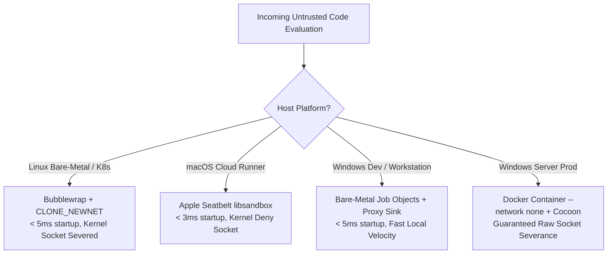

# Cocoon Sandbox: Builder & Architecture Guide

This skill is designed for **Builder Agents, Platform Engineers, and Solution Architects** who need to design, provision, configure, and embed `cocoon-sandbox` into agent harnesses, CI/CD pipelines, evaluation engines, or production backends.

*For complete enterprise deployment topologies, raw socket severance, Kubernetes pod specs, and production container blueprints, see the [Enterprise & Production Deployment Guide](../../../docs/ENTERPRISE_PRODUCTION_GUIDE.md).*

---

## 🏛️ 1. The Core Architectural Philosophy

### The Chassis Policy vs. Model Agency Rule
When building an agentic execution harness with Cocoon, you must enforce a strict separation between **Policy** and **Agency**:

> [!IMPORTANT]
> **The host chassis, NOT the language model, must decide the execution profile.**  
> The LLM should only ever be given agency over the code payload (`code: string`).  
> Privileged flags (`--allow-network`, `--rw`, `--mem`, `--no-gpu`, `-r python-skill`) must be determined deterministically by the chassis based on the business workflow.

If an LLM tool schema exposes `--allow-network` or `--rw`, a prompt injection or jailbreak can persuade the model to disable sandbox protections. By enforcing the policy in the chassis wrapper (via the Python SDK, MCP tool definition, or CLI invocation), security boundaries remain unbreachable regardless of model behavior.

---

## 📊 2. The 5 Business Use-Case Archetypes

Before configuring a sandbox, identify which archetype matches the business requirements:

| Archetype | Typical Workload | Network | Filesystem Mounts | Memory & CPU | Timeout | GPU Drivers |
| :--- | :--- | :---: | :---: | :---: | :---: | :---: |
| **A. Untrusted Code Eval** | User-submitted code, algorithm grading, untrusted scripts | ❌ Disabled | `--ro .` (Read-only CWD)<br>Ephemeral scratchpad | 512 MB RAM<br>95% CPU Cap | 30s | ❌ Detached (`--no-gpu`) |
| **B. Data & Document Skills** | Excel (`openpyxl`), Word (`python-docx`), PDF, Pandas ETL | ❌ Disabled | `--ro <inputs>`<br>`--work <output_dir>` or `--copy` | 2–4 GB RAM<br>95% CPU Cap | 60–180s | ❌ Detached (`--no-gpu`) |
| **C. Package & Toolchain Build** | `npm install`, `cargo build`, compiling binaries, package builds | ✅ Enabled | `--work <project_root>`<br>Custom `--temp` | 4–8 GB RAM<br>95% CPU Cap | 180–600s | ❌ Detached (`--no-gpu`) |
| **D. Local AI & Inference** | PyTorch embeddings, Whisper audio, local small LLMs | ❌ Disabled | `--ro <models>`<br>Ephemeral scratchpad | 4–16 GB RAM<br>95% CPU Cap | 120–600s | ✅ Attached (Default) |
| **E. In-Place Code Refactoring** | Running `prettier -w`, `rustfmt`, applying multi-file diffs | ❌ Disabled | `--work <repo_root>` (Read-Write)<br>Exclude parent dirs | 1–2 GB RAM<br>95% CPU Cap | 60–120s | ❌ Detached (`--no-gpu`) |

---

## ⚙️ 3. Configuration Knobs Master Reference

This section details every configuration parameter, what it does, and when to enable, disable, include, or exclude it.

### Group 1: Network Boundary

* **Default Behavior**: Disabled.
  * **Linux**: Kernel network namespace unshared (`CLONE_NEWNET`). Raw sockets fail with `Network is unreachable`.
  * **macOS**: Apple Seatbelt profile omits `(allow network*)`. Sockets blocked by `libsandbox`.
  * **Windows**: Proxy sinking (`HTTP_PROXY`, `HTTPS_PROXY`, `ALL_PROXY`, `NO_PROXY` redirected to `127.0.0.1:0`). Cooperative HTTP clients fail immediately.
* **When to Enable (`--allow-network` / `allow_network: true`)**:
  * **Include for**: Archetype C (Package installation via `pip`, `npm`, `cargo`, `go get`, or API ingestion pipelines).
  * **Exclude/Disable for**: Archetypes A, B, D, E.
  * **Architectural Safeguard**: When enabling network, **never** inherit host credential environment variables (`inherit_env: false`).

---

### Group 2: Filesystem & Workspace Isolation

* **Read-Only Mounts (`--ro <path>` / `MountType::ReadOnly`)**:
  * **Include for**: Source repositories, raw datasets, reference manuals, model weights.
  * **Behavior**:
    * Linux: Read-only bind mount (`--ro-bind`).
    * macOS: Seatbelt `(subpath ...)` under `file-read*`.
    * Windows: Native NTFS Deny ACE (`(DE,DC,WD,AD)`) blocking modification, deletion, and file creation.
  * **Rule**: Always mount the current directory or source dataset with `--ro` unless in-place refactoring is explicitly required.

* **Dedicated Work Directory (`--work <path>` / `working_dir`)**:
  * **Include for**: When the business process expects output files (e.g. `./reports/summary.xlsx`, `./dist/bundle.js`).
  * **Exclude for**: Pure calculation or evaluation tasks (let the sandbox use the auto-cleaned ephemeral scratchpad).
  * **Rule**: Bounded strictly to the executing user DACL (`%USERNAME%`), never `Everyone` (`*S-1-1-0`).

* **Copy-on-Write Staging (`--copy <path>` / `stage_copies`)**:
  * **Include for**: Safely modifying or experimenting on host files without touching originals (e.g. editing a config file or running tests on a cloned module).
  * **Mechanism**: Cocoon deep-copies the requested host path into the writable sandbox workspace before starting the child process.

* **Temporary Directory (`--temp <path>` / `temp_dir`)**:
  * **Include for**: Custom build drives (e.g. high-speed NVMe or RAM-disk) or when redirecting large compiler cache files (`TMP`, `TEMP`, `TMPDIR`).

---

### Group 3: Resource Limiting & Hardware Protection

* **Memory Cap (`--mem <MB>` / `memory_limit_mb`)**:
  * **Archetype A**: `512` MB.
  * **Archetype B & E**: `2048`–`4096` MB.
  * **Archetype C & D**: `8192`+ MB.
  * **Enforcement**:
    * Linux: Kernel `RLIMIT_AS`.
    * macOS: `setrlimit(libc::RLIMIT_AS)`.
    * Windows: Win32 Job Object `JOB_OBJECT_LIMIT_PROCESS_MEMORY` & `JOB_OBJECT_LIMIT_JOB_MEMORY`.
  * **Hardware Ceiling**: Cocoon automatically caps allocation to **95% of host physical RAM** regardless of user input, preventing host OS lockup or paging thrash.

* **Execution Timeout (`--timeout <seconds>` / `timeout`)**:
  * **Archetype A**: `30` seconds (default).
  * **Archetype B & E**: `60`–`180` seconds.
  * **Archetype C & D**: `300`–`600` seconds.
  * **Rule**: Never set timeout to infinite or 0 in automated agent chassis.

* **Disk Quota (`--disk <MB>` / `disk_limit_mb`)**:
  * **Default**: `512` MB.
  * **Relax to**: `2048`–`10240` MB for package builds (`npm install`, `cargo build`).
  * **Enforcement**: In-flight `RLIMIT_FSIZE` on Linux; post-run scan and teardown verification on Windows.

* **CPU Cap (`--cpu <PCT>` / `cpu_limit_pct`)**:
  * **Default**: `95`% of host physical capacity.
  * **Rule**: Hard-clamped between 1% and 95% to preserve host OS responsiveness.

* **Process Cap (`--max-procs <count>` / `max_processes`)**:
  * **Default**: `32`.
  * **Rule**: Prevents fork bombs and unbounded process trees (`RLIMIT_NPROC` on Linux/macOS, Job Object active process cap on Windows).

---

### Group 4: Hardware Acceleration & GPU Isolation

* **GPU Detachment (`--no-gpu` / `allow_gpu: false`)**:
  * **Include/Enable for**: Archetype D (Local ML inference, PyTorch, Whisper).
  * **Disable/Mask for**: Archetypes A, B, C, E.
  * **Detachment Action**: Sets `CUDA_VISIBLE_DEVICES=""`, `ROCR_VISIBLE_DEVICES=""`, `HIP_VISIBLE_DEVICES=""`, `OPENCL_DEVICE_NAME=""`, `GPU_DEVICE_ORDINAL=""`, `NVIDIA_VISIBLE_DEVICES="void"`, `ONEAPI_DEVICE_SELECTOR="none"`.
  * **Safety Guard**: When GPU is permitted, Cocoon automatically injects `PYTORCH_CUDA_ALLOC_CONF="max_split_size_mb:128"` to prevent CUDA VRAM fragmentation.

---

### Group 5: Environment & Identity Sanitization

* **Environment Inheritance (`inherit_env: false`)**:
  * **Exclude host secrets**: Strips `AWS_ACCESS_KEY_ID`, `AWS_SECRET_ACCESS_KEY`, `GITHUB_TOKEN`, `OPENAI_API_KEY`, `ANTHROPIC_API_KEY`, `GEMINI_API_KEY`.
* **Desktop & Clipboard Isolation**:
  * **Windows**: Always locked via Win32 Job Object (`JOB_OBJECT_UILIMIT_READCLIPBOARD`, `JOB_OBJECT_UILIMIT_WRITECLIPBOARD`, `JOB_OBJECT_UILIMIT_HANDLES`, `JOB_OBJECT_UILIMIT_DESKTOP`).
  * **Linux**: Namespaces unshared (`--unshare-all`).
  * **macOS**: SBPL denies Mach pasteboard and WindowServer lookup.
* **Core Dump Suppression**:
  * Always active (`RLIMIT_CORE=0` on Unix, WER popup suppression on Windows).

---

## 🚫 4. The 4 Inviolable Invariants (Never Relax)

Even when building a "relaxed" profile for package builds or ML workloads, the builder agent **must NEVER** disable these 4 invariants:

1. **Clipboard & Desktop UI Restrictions**: Guest code never needs OS clipboard access or window hooks to perform compute tasks.
2. **The 95% Hardware Ceiling**: Never disable the 95% physical RAM/CPU clamps; exceeding this threshold risks hard kernel panics or host freeze.
3. **Core Dump Suppression**: Allowing core dumps risks writing prompt history, secret keys, and multi-gigabyte memory images to disk on crash.
4. **Host Identity & Unprivileged Boundary**: Never execute guest code under elevated `root` or `Administrator`. Keep DACLs bounded strictly to `%USERNAME%`.

---

## 🏗️ 5. Implementation Blueprints for Builder Agents

### Blueprint 1: Python Client SDK Integration

When building a Python backend or autonomous agent toolset, use the `cocoon` Python SDK:

```python
from pathlib import Path
from cocoon import run, pipeline, doctor

class SandboxService:
    def __init__(self, workspace_root: Path):
        self.workspace_root = workspace_root

    def evaluate_untrusted_code(self, code: str, runtime: str = "python"):
        """Archetype A: Untrusted Code Evaluation."""
        return run(
            code=code,
            runtime=runtime,
            ro=[self.workspace_root],
            timeout=30,
            mem=512,
            allow_network=False,
            no_gpu=True,
        )

    def generate_excel_report(self, script: str, data_dir: Path, output_dir: Path):
        """Archetype B: Data Analytics & Document Processing."""
        return run(
            code=script,
            runtime="python-skill",
            ro=[data_dir],
            work=output_dir,
            timeout=120,
            mem=2048,
            allow_network=False,
            no_gpu=True,
        )

    def build_project(self, build_command: list[str], project_dir: Path):
        """Archetype C: Package Installation & Toolchain Build."""
        return run(
            raw_cmd=build_command,
            work=project_dir,
            timeout=300,
            mem=4096,
            disk=4096,
            allow_network=True,  # Relaxed for downloading dependencies
            no_gpu=True,
        )
```

---

### Blueprint 2: Native Model Context Protocol (MCP) Server Setup

When deploying Cocoon for Claude Desktop, Cursor, Antigravity, or AutoGen, launch the embedded MCP server:

```bash
cocoon mcp
```

**MCP Tool Architecture (Hardened Schema for Agents)**:
* `execute_code`: Accepts `code`, `runtime`, `timeout`, and optional `work_dir`. (Network is hardcoded to `false`, GPU is hardcoded to `false`).
* `execute_skill`: Accepts `code`, `input_files` (mounted as read-only), `work_dir`, and `timeout`.
* `inspect_runtimes`: Discovers available toolchains on the host.
* `doctor`: Runs diagnostic verification checks.

---

### Blueprint 3: Declarative JSON Profile Pattern

For orchestrators that manage multiple environments, you can define profiles in a JSON/YAML configuration file:

```json
{
  "profiles": {
    "untrusted_eval": {
      "runtime": "python",
      "timeout": 30,
      "mem_mb": 512,
      "disk_mb": 256,
      "allow_network": false,
      "allow_gpu": false,
      "mounts_ro": ["."]
    },
    "document_worker": {
      "runtime": "python-skill",
      "timeout": 120,
      "mem_mb": 2048,
      "disk_mb": 1024,
      "allow_network": false,
      "allow_gpu": false
    },
    "package_builder": {
      "timeout": 300,
      "mem_mb": 4096,
      "disk_mb": 8192,
      "allow_network": true,
      "allow_gpu": false
    },
    "ai_inference": {
      "runtime": "python",
      "timeout": 300,
      "mem_mb": 8192,
      "disk_mb": 2048,
      "allow_network": false,
      "allow_gpu": true
    }
  }
}
```

---

### Blueprint 4: Production Container & Zero-Trust Backend Deployment

When provisioning Cocoon in enterprise production, follow the platform deployment topology matrix:



#### 1. Polyglot Production Presets Hardening
When architects configure non-Python runtimes in production, enforce runtime-specific flags:
* **Node.js**: Runs with `--no-addons` to prevent native C++ binary module hijacking.
* **Bun**: Runs with `--no-addons` and sandbox env protections.
* **Deno**: Runs hermetically without `--allow-net` or `--allow-run`.
* **Go**: Isolates build artifacts by overriding `GOCACHE` and `GOTMPDIR` to the ephemeral scratchpad.
* **Rust / Cargo**: Directs `CARGO_TARGET_DIR` and `CARGO_HOME` to ephemeral scratchpad.
* **Java**: Constrains JVM heap using `-XX:MaxRAMPercentage=90` to align with the 95% physical hardware ceiling.
* **Ruby**: Disables Rubygems loading via `--disable-gems`.
* **Bash / PowerShell**: Runs non-interactive (`-NoProfile -NonInteractive` / `--noprofile --norc`).

#### 2. Windows Production Docker Blueprint
If the production infrastructure runs on Windows Server and enterprise compliance requires absolute raw socket refusal, wrap the execution inside a minimal hardened container:

```bash
docker run --rm \
  --network none \
  --memory 2g \
  --cpus 2.0 \
  -v "C:\data:C:\data:ro" \
  -v "C:\workspace:C:\workspace:rw" \
  ghcr.io/sunilksundaram/cocoon-sandbox:latest \
  cocoon run --ro C:\data --work C:\workspace --runtime python -c "print('Hardened Prod Execution')" --json
```

For full Kubernetes Pod manifests, FastAPI worker pools, and SIEM logging configurations, consult the [Enterprise & Production Deployment Guide](../../../docs/ENTERPRISE_PRODUCTION_GUIDE.md).

---

## 🩺 6. Verification & Self-Test Procedures

Before putting any newly configured chassis into production, the builder agent should execute the diagnostic suite:

1. **Run the Environment Doctor**:
   ```bash
   cocoon doctor --json
   ```
   Verify that `all_passed: true` and that the platform driver is `ACTIVE`.

2. **Verify Breakout Defense**:
   Ensure that attempting to write to a read-only mount fails:
   ```bash
   cocoon run --ro . -r python -c "open('test_exploit.txt', 'w').write('fail')" --json
   ```
   Expected: `exit_code != 0`, `stderr` contains `PermissionError: Permission denied`.

3. **Verify Anti-Escape Symlink / Junction Defense**:
   Ensure that creating symlinks or junctions pointing outside the workspace triggers `verify_no_breakouts`:
   ```bash
   cocoon run -r pwsh -c "New-Item -ItemType Junction -Path escape -Target C:\Windows" --json
   ```
   Expected: Execution rejected with `SecurityViolation: Detected path escape pointing outside workspace`.

---

## 💡 7. High-Value Architectural Design Patterns

### Pattern 1: The "File-to-File + 1-Line Digest" Pattern
* **Problem**: Agents that dump large tables or query extracts directly to `stdout` trigger Cocoon's 10 MB buffer limit (`stdout_truncated: true`) and rapidly exhaust the LLM's context window.
* **Architecture**: Direct the agent to write the full payload to an artifact file (`.parquet`, `.csv`, `.jsonl`, `.xlsx`) inside `--work`, and print only a concise 1-line JSON digest to `stdout`:
  ```python
  # Good Agent Script
  df.to_parquet("summary.parquet")
  print(json.dumps({"status": "ok", "rows": len(df), "columns": list(df.columns), "file": "summary.parquet"}))
  ```

---

### Pattern 2: Two-Phase Ingestion & Isolation Pipeline
* **Problem**: An agent needs to fetch data from an external API or package registry, but executing untrusted parsing code with network enabled creates an exfiltration hazard.
* **Architecture**: Split the task into two deterministic phases:
  1. **Phase 1 (Fetch - Network ON, Code Constrained)**: Script fetches raw payload from remote endpoint and writes it to `./staging/raw.json`.
  2. **Phase 2 (Compute - Network OFF, Default-Deny)**: Sandboxed worker mounts `./staging` as strictly read-only (`--ro ./staging`), analyzes the data, and writes reports to `./output`.
  * **Guarantee**: Untrusted code never has both network access and sensitive host outputs simultaneously.

---

### Pattern 3: Staged Copy-on-Write (CoW) for Safe Refactoring
* **Problem**: Granting write permissions (`--rw`) to an existing project root allows buggy or hallucinated agent code to overwrite or delete files irreversibly.
* **Architecture**: Mount the repository as read-only (`--ro ./repo`), and pass `--copy ./repo/target_module.py` into `--work ./scratch`. The agent modifies and runs tests against the staged copy. Only when all tests pass does the host chassis commit the diff back to the repository.

---

### Pattern 4: The Polyglot Data Relay
* **Problem**: Complex pipelines often require different languages (e.g. Python for ML, Node/Bun for TypeScript transformations, PowerShell for system tasks). Orchestrating them via separate Docker containers introduces 2–5 second startup overhead per step.
* **Architecture**: Use `cocoon pipeline` to chain execution steps sequentially within the **exact same virtual workspace**:
  ```bash
  cocoon pipeline \
    -s "python:import json; json.dump({'data': [1,2,3]}, open('data.json','w'))" \
    -s "bun:const d = JSON.parse(require('fs').readFileSync('data.json')); console.log(d.data.length);" \
    --json
  ```
  * **Benefit**: Startup latency is `< 5ms` per step; data is shared at raw NVMe bus speed without inter-process serialization overhead.

---

### Pattern 5: Telemetry-Informed Agent Remediation
* **Problem**: When a script crashes, agents often retry the exact same code repeatedly, wasting API tokens and execution time.
* **Architecture**: Feed Cocoon's structured JSON telemetry directly into the agent's error-recovery prompt:
  * If `exit_code: 137` and `oom_killed: true` $\to$ Instruct model to use streaming iterators/generators instead of loading all data into memory.
  * If `exit_code: 124` and `timed_out: true` $\to$ Instruct model to optimize the algorithmic complexity or increase chunk batching.
  * If `stdout_truncated: true` $\to$ Instruct model to write output to file instead of printing.

---

## ⚠️ 8. Critical Antipatterns to Avoid

| Antipattern | Description | Risk & Consequence | Recommended Fix |
| :--- | :--- | :--- | :--- |
| **1. The Model in the Driver's Seat** | Exposing `--allow-network` or `--rw` directly in LLM tool parameter schemas. | Prompt injection or jailbreaks convince the model to disable sandbox isolation. | Chassis, not model, picks the profile. Tool schema only accepts `code: string`. |
| **2. The Blind Retry Loop** | Automatically retrying a script 3–5 times upon failure without inspecting telemetry. | Infinite OOM kills, prolonged timeouts, and token exhaustion. | Branch logic on `termination_reason` (`MemoryExceeded`, `Timeout`). |
| **3. The Mega Stdout Dump** | Printing entire SQL extracts or large dataframes directly to `stdout`. | Triggers `stdout_truncated: true`, buffer memory bloat, and context blowout. | Write payload to `--work <file>` and output a 1-line JSON summary. |
| **4. Host Temp Leakage** | Letting scripts create temp files in host `/tmp` or `%TEMP%`. | Temp file accumulation, cache poisoning, and cross-session data leaks. | Rely on Cocoon's auto-cleaned ephemeral `Scratchpad` / `temp_holder`. |
| **5. Unbounded Timeouts** | Setting `--timeout 0` or omitting timeout on long tasks. | Infinite loops or hung network calls freeze agent workers indefinitely. | Always set an explicit timeout (e.g. 30s to 300s); use `--stream` for progress tracking. |
| **6. The Everyone DACL** | Granting `*S-1-1-0` (`Everyone`) permissions on Windows workspaces. | Other unprivileged processes or local sessions can hijack the workspace. | Bind DACLs strictly to `%USERNAME%` (Cocoon default). |


