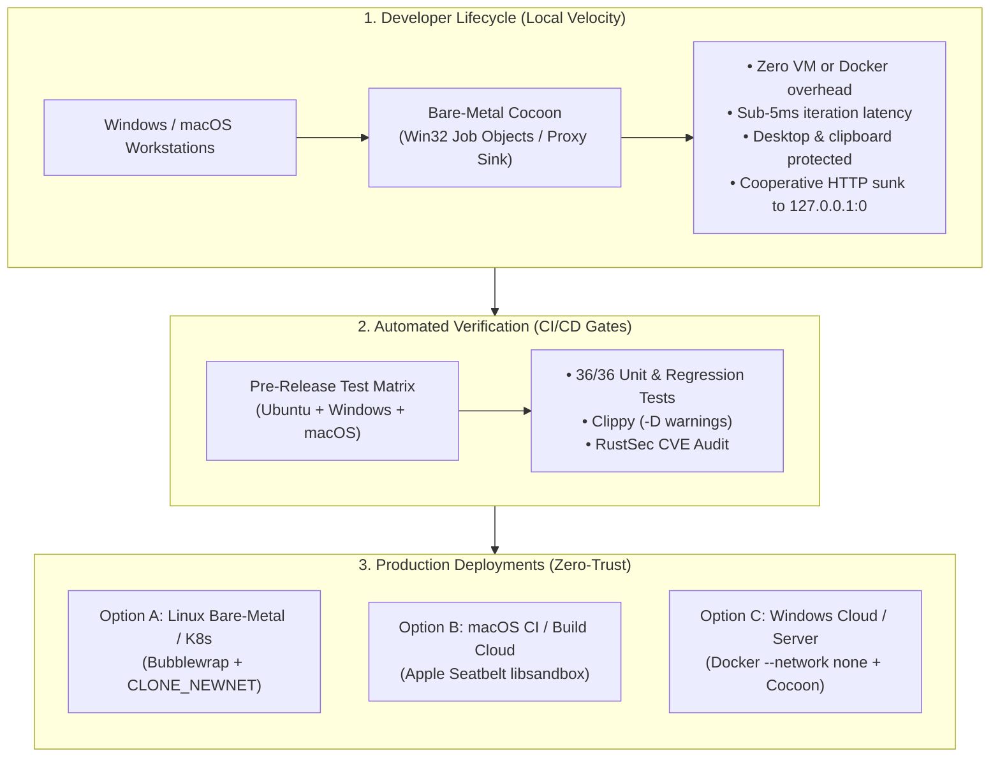
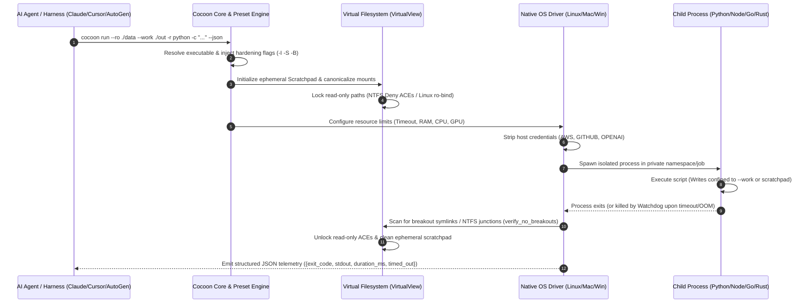

# Cocoon Enterprise & Production Deployment Guide 🏛️

> A comprehensive architectural guide for platform engineers, security architects, and enterprise teams deploying Cocoon in production environments, multi-tenant agent harnesses, and high-density compute clusters.

---

## 1. Executive Architecture Summary

Cocoon delivers ultra-low-latency (< 5ms) sandboxing for **13+ programming languages** by leveraging native operating system isolation primitives instead of running heavyweight virtual machines. 

In enterprise environments, security requirements differ between **local developer velocity** and **zero-trust production backends**. Cocoon supports a battle-tested two-tier lifecycle model:



---

## 2. The 3 Enterprise Production Topologies

Depending on your production infrastructure and compliance mandates, select the appropriate topology:

### Topology A: Linux Bare-Metal, High-Density VMs, or Kubernetes (Recommended)
* **Underlying Primitive**: Bubblewrap (`bwrap`) with unprivileged user namespaces and cgroups.
* **Network Boundary**: **True Kernel-Level Severance (`CLONE_NEWNET`)**. Raw sockets, TCP, UDP, and ICMP packets are rejected by the Linux kernel with `Network is unreachable`.
* **Filesystem Boundary**: Private mount namespaces with read-only bind mounts (`--ro-bind`) and ephemeral tmpfs.
* **Latency & Footprint**: **< 5ms startup**, raw NVMe bus speed (3–7 GB/s), zero container virtualization penalty.
* **Target Workloads**: Multi-tenant cloud backends, LLM evaluation pipelines, autonomous coding agents, API data processing.

---

### Topology B: macOS Cloud Runners (MacStadium, AWS EC2 Mac, Apple Silicon)
* **Underlying Primitive**: Apple Seatbelt (`libsandbox` via dynamic Sandbox Profile Language - SBPL).
* **Network Boundary**: **Kernel-Level Socket Refusal**. The dynamic SBPL profile strictly enforces `(deny default)` without `(allow network*)`. Socket creation syscalls return `EPERM`.
* **Filesystem Boundary**: In-memory SBPL rules grant read-only access to host toolchains (`/System`, `/Library`, `/usr`) without modifying disk ACLs.
* **Latency & Footprint**: **< 3ms startup**, native Apple Silicon M-series acceleration.
* **Target Workloads**: iOS/macOS CI/CD pipelines, Swift/Xcode toolchains, local Mac agent workers.

---

### Topology C: Windows Production (Containerized with Docker or Podman)
* **Underlying Primitive**: Linux Container with `--network none` wrapping Cocoon.
* **Why this is required on Windows Server**:
  * On bare-metal Windows, Win32 Job Objects provide CPU, memory, process tree, and desktop/clipboard isolation, but **do not virtualize the TCP/IP network stack**.
  * Bare-metal Windows relies on **cooperative proxy sinking** (`127.0.0.1:0`), which blocks standard clients (`pip`, `npm`, `requests`, `curl`), but does not sever raw TCP sockets created via compiled languages (C, Go, Rust) or custom assembly syscalls.
* **The Solution**: Run Cocoon inside a Linux container (`docker run --network none ...`).
  * **Docker** provides the impenetrable kernel-level network barrier (`--network none`).
  * **Cocoon** inside the container provides the sub-5ms multi-language runtime dispatch, memory caps, copy-on-write virtual views, and structured agent telemetry (`--json`, `--stream`).

---

## 3. Polyglot Runtime Hardening Matrix (13+ Languages)

Cocoon isolates every language preset using a combination of runtime-specific defensive flags and platform environment sanitization:

| Language | Preset Flag | Automated Defensive Arguments Injected | Isolation Guarantees |
| :--- | :---: | :--- | :--- |
| **Python** | `-r python` | `-I -S -B` | Runs isolated from user site-packages, ignores host environment, disables `.pyc` disk pollution. |
| **Python Skills** | `-r python-skill` | `-B` | Enables format manipulation packages (`openpyxl`, `docx`, `pandas`) while blocking bytecode writes. |
| **Node.js** | `-r node` | `--no-addons` | Disallows loading unverified native C++ binary addons (`.node`). |
| **Bun** | `-r bun` | `--no-install` | Completely blocks background auto-fetching of missing npm packages. |
| **Deno** | `-r deno` | `eval --no-prompt` / `run --no-prompt` | Terminates immediately if untrusted code attempts an interactive permission prompt. |
| **PowerShell** | `-r pwsh` | `-NoProfile -NonInteractive -ExecutionPolicy Bypass` | Bypasses polluted host profiles and blocks interactive prompts. |
| **Bash** | `-r bash` | `--noprofile --norc` | Prevents executing malicious user startup configurations. |
| **Go** | `-r go` | `run -mod=readonly` | Strictly forbids network-based module resolution and downloads. |
| **Rust** | `-r rust` | `script --offline` | Forces offline compilation and local crate resolution. |
| **Ruby** | `-r ruby` | `--disable-gems` | Disables Rubygems to prevent loading unverified host packages. |
| **PHP** | `-r php` | `-n` | Ignores host `php.ini` to enforce safe default interpreter settings. |
| **Java** | `-r java` | `java <file>` | Runs single-file source code or pre-compiled JARs without local persistence. |
| **Custom Compilers** | `-- <cmd>` | User-specified (`clang`, `gcc`, `dotnet`, `zig`) | Enforces memory, CPU, timeout, and filesystem boundaries around any binary. |

---

## 4. End-to-End Execution Flow Architecture



---

## 5. Enterprise Sizing & Capacity Planning

| Metric | Default Setting | Enterprise Production Recommendation | Rationale |
| :--- | :---: | :---: | :--- |
| **Execution Timeout** | `30s` | `10s` – `60s` | Always set a hard ceiling. Never set timeout to `0` or infinite in production agent harnesses. |
| **RAM Ceiling** | Auto-detected | Hard-capped at **95% of Physical RAM** | Cocoon clamps memory to 95% maximum to prevent host OS kernel paging thrash or host freeze. |
| **CPU Rate Limit** | `95%` | `50%` – `90%` per worker | Clamped to preserve scheduler responsiveness for host services and supervisor processes. |
| **Active Processes** | `32` | `16` – `64` | Prevents fork bombs (`:(){ :|:& };:`) from exhausting kernel PID tables. |
| **Disk Write Quota** | `512 MB` | `256 MB` – `2048 MB` | Enforced in-flight via `RLIMIT_FSIZE` on Linux and verified on teardown on Windows. |
| **Output Buffer** | `10 MB` | Fixed ceiling | Prevents guest code from blowing out supervisor memory by printing gigabytes to `stdout`. |

---

## 6. Enterprise Integration Blueprints

### Blueprint 1: Kubernetes Production Pod Spec (Linux High-Assurance)
Deploying Cocoon inside Kubernetes pods with strict unprivileged security contexts:

```yaml
apiVersion: apps/v1
kind: Deployment
metadata:
  name: cocoon-agent-worker
  namespace: agent-sandbox
spec:
  replicas: 5
  template:
    metadata:
      labels:
        app: cocoon-worker
    spec:
      containers:
        - name: worker
          image: ghcr.io/sunilksundaram/cocoon-sandbox:0.2.2
          command: ["cocoon", "mcp"]
          resources:
            limits:
              cpu: "4"
              memory: 8Gi
            requests:
              cpu: "1"
              memory: 2Gi
          securityContext:
            allowPrivilegeEscalation: false
            readOnlyRootFilesystem: true
            runAsNonRoot: true
            runAsUser: 10001
            capabilities:
              drop: ["ALL"]
          volumeMounts:
            - mountPath: /tmp
              name: ephemeral-scratchpad
      volumes:
        - name: ephemeral-scratchpad
          emptyDir:
            medium: Memory
            sizeLimit: 2Gi
```

---

### Blueprint 2: Production Dockerfile (Windows Host or Air-Gapped Cloud)
For hosting Cocoon with guaranteed raw-socket severance:

```dockerfile
FROM ubuntu:24.04

# Install essential polyglot language toolchains
RUN apt-get update && apt-get install -y --no-install-recommends \
    bubblewrap \
    ca-certificates \
    curl \
    python3 \
    python3-pip \
    nodejs \
    npm \
    golang-go \
    openjdk-21-jre-headless \
    && rm -rf /var/lib/apt/lists/*

# Install Cocoon release binary
COPY target/x86_64-unknown-linux-gnu/release/cocoon /usr/local/bin/cocoon
RUN chmod +x /usr/local/bin/cocoon

# Create unprivileged service user
RUN useradd -m -u 10001 sandboxuser
USER sandboxuser
WORKDIR /home/sandboxuser

# Run with network completely severed
# Usage: docker run --rm --network none -i cocoon-worker cocoon mcp
ENTRYPOINT ["cocoon"]
CMD ["mcp"]
```

---

### Blueprint 3: High-Throughput Python Agent Backend Service
Using the native Python SDK (`import cocoon`) in a production FastAPI or Celery task worker:

```python
from pathlib import Path
from fastapi import FastAPI, HTTPException
from pydantic import BaseModel
import cocoon

app = FastAPI(title="High-Assurance Agent Sandbox API")

class ExecutionRequest(BaseModel):
    code: str
    runtime: str = "python"
    timeout_secs: int = 30

@app.post("/execute")
def execute_untrusted_code(req: ExecutionRequest):
    # Enforce policy in the chassis (host), NOT from model input
    result = cocoon.run(
        code=req.code,
        runtime=req.runtime,
        timeout=min(req.timeout_secs, 60), # Clamp to 60s max
        mem=1024,                          # 1 GB RAM cap
        disk=256,                          # 256 MB disk cap
        allow_network=False,               # Default-deny network
        no_gpu=True                        # Isolate GPU
    )

    if result.timed_out:
        raise HTTPException(status_code=408, detail="Execution timed out")
    if result.oom_killed:
        raise HTTPException(status_code=413, detail="Memory allocation limit exceeded")

    return {
        "exit_code": result.exit_code,
        "stdout": result.stdout,
        "stderr": result.stderr,
        "duration_ms": result.duration_ms,
        "peak_memory_mb": result.peak_memory_mb,
    }
```

---

## 7. SIEM & Centralized Audit Logging (`--log-json`)

In regulated environments (SOC2, ISO 27001, HIPAA), sandbox executions must produce immutable audit trails. Appending `--log-json` produces real-time structured telemetry ready for Splunk, Datadog, or AWS CloudWatch:

```bash
cocoon --log-json run --ro ./data -r python -c "print('Audit Event')"
```

**JSON Log Event:**
```json
{
  "timestamp": "2026-11-01T12:00:00.124Z",
  "level": "INFO",
  "target": "cocoon_platform::linux",
  "fields": {
    "message": "Process execution complete",
    "driver": "linux-bubblewrap",
    "executable": "/usr/bin/python3",
    "exit_code": 0,
    "duration_ms": 18.4,
    "timed_out": false,
    "oom_killed": false,
    "peak_memory_mb": 14,
    "security": {
      "network_severed": true,
      "read_only_mounts": ["/app/data"],
      "breakout_detected": false
    }
  }
}
```

---

## 8. Pre-Flight Production Health Check

Before routing production traffic to any agent node, verify that all security subsystems and compilers are operational:

```bash
cocoon doctor --json
```

Verify that:
1. `driver_available` is `true`.
2. `all_passed` is `true`.
3. Required compilers are listed under `runtimes` with `available: true`.

