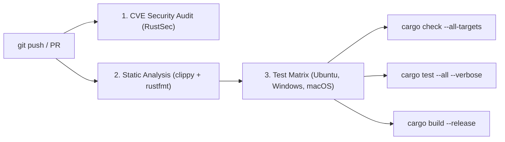
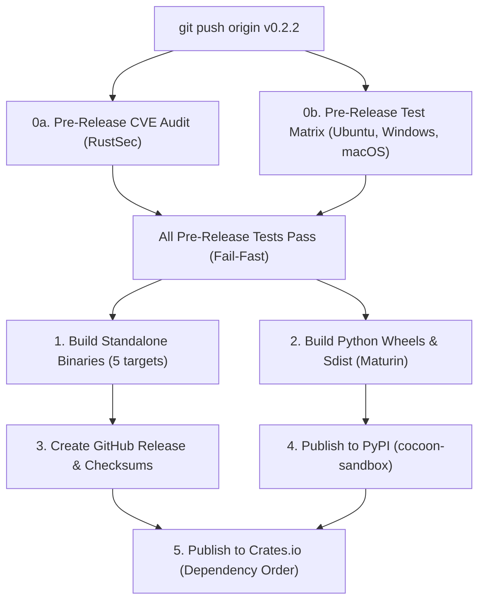

# Cocoon Integration & User Guide 📖

> A complete guide for using Cocoon as a standalone sandbox, with major agent frameworks (Microsoft Agent Framework, LangChain, LangGraph, LlamaIndex), and agent harnesses (Claude Desktop, GitHub Copilot, Hermes, Cursor, Antigravity, and custom agent loops).

👉 *Need setup or prerequisite instructions? See the [Installation Guide](INSTALLATION.md) and the [Security & Vulnerability Remediation Guide](SECURITY_AND_VULNERABILITIES.md).*

---

## ⚡ Why Cocoon for AI Agents?

Cocoon is purpose-built for AI agents and code execution:
* **Zero Host Risk:** Current directory is read-only (`--ro .`) by default; writes are strictly jailed to `--work`.
* **Sub-Millisecond Startup:** No container or VM initialization latency (< 5ms) — runs directly on native OS isolation primitives (Windows Job Objects/ACLs and Linux Namespaces/cgroups).
* **Automated 30-Second Timeout:** Runaway scripts or infinite loops are terminated automatically.
* **Agent-First JSON Telemetry:** Emits structured output (`--json`) with exit codes, execution duration, and standard streams.
* **Polyglot:** Built-in presets for Python, Node.js, Bun, Deno, Go, Java, Rust/Cargo, PowerShell, Bash, Ruby, PHP, and Lua.

---

## 1. Standalone CLI Usage

### Quick Reference
```bash
# 1. Safe execution (current directory is read-only, default-deny network, 30s timeout)
cocoon run -r python -c "print(2 + 2)"

# 2. Run inside an explicit writable workspace with disk quota
cocoon run --work ./my_workspace --disk 256 -r node -c "require('fs').writeFileSync('out.txt', 'done')"

# 3. Copy-on-Write: Stage repository files into workspace and manipulate them safely
cocoon run --copy ./config.json --work ./workspace -r python -c "
import json
d = json.load(open('config.json'))
d['active'] = True
json.dump(d, open('config.json', 'w'))
"

# 4. Opt-in network access (when task explicitly requires outbound HTTP requests)
cocoon run --allow-network -r node -c "console.log('Fetching external API...')"

# 5. Polyglot Multi-Language Pipeline (Python -> Node -> Bun in the SAME virtual workspace)
cocoon pipeline \
  -s "python:open('data.txt', 'w').write('hello from python')" \
  -s "node:console.log('Read by Node:', require('fs').readFileSync('data.txt', 'utf8'))" \
  -s "bun:console.log('Read by Bun:', await Bun.file('data.txt').text())" \
  --json

# 6. Structured SIEM JSON Logging
cocoon --log-json run -r python -c "print('Audit log event')"

# 7. Inspect available runtimes on host
cocoon info
```

---

## 2. Universal Tool Definition (OpenAI / JSON-RPC Schema)

Any agent harness using standard function calling can use this tool schema:

```json
{
  "name": "cocoon_run",
  "description": "Safely execute code in an isolated sandbox with read-only host protection and a 30s timeout. Writes are only permitted in the designated work folder.",
  "parameters": {
    "type": "object",
    "properties": {
      "runtime": {
        "type": "string",
        "enum": ["python", "python-skill", "node", "bun", "deno", "go", "java", "rust", "pwsh", "bash", "ruby", "php", "lua"],
        "description": "The programming language runtime to execute. Use 'python' for untrusted code (stdlib only) or 'python-skill' for format packages (openpyxl, docx)."
      },
      "code": {
        "type": "string",
        "description": "Inline code snippet to execute."
      },
      "workdir": {
        "type": "string",
        "description": "Optional directory for writing outputs. If omitted, uses an ephemeral scratchpad."
      },
      "copy_paths": {
        "type": "array",
        "items": { "type": "string" },
        "description": "Paths to copy into the work folder before execution for safe modification."
      },
      "timeout_seconds": {
        "type": "integer",
        "default": 30,
        "description": "Maximum allowed execution time in seconds."
      },
      "allow_network": {
        "type": "boolean",
        "default": false,
        "description": "Whether to permit outbound HTTP/network access. Defaults to false (blocked) to prevent credential exfiltration."
      },
      "max_processes": {
        "type": "integer",
        "default": 32,
        "description": "Maximum active process cap to prevent fork bombs."
      },
      "disk_mb": {
        "type": "integer",
        "default": 512,
        "description": "Disk write quota in Megabytes for the workspace."
      }
    },
    "required": ["runtime", "code"]
  }
}
```

---

## 3. Microsoft Agent Framework (AutoGen & Semantic Kernel)

### A. Microsoft AutoGen
In AutoGen, register Cocoon as a custom tool:

```python
import json
import subprocess
from autogen_agentchat.agents import AssistantAgent
from autogen_core.tools import FunctionTool

def execute_sandboxed_code(
    runtime: str,
    code: str,
    workdir: str = None,
    timeout: int = 30
) -> str:
    """Executes code inside the secure Cocoon sandbox."""
    cmd = ["cocoon", "run", "-r", runtime, "-c", code, "--json"]
    if workdir:
        cmd.extend(["--work", workdir])
    if timeout:
        cmd.extend(["--timeout", str(timeout)])
    
    proc = subprocess.run(cmd, capture_output=True, text=True)
    try:
        data = json.loads(proc.stdout)
        if data["exit_code"] != 0:
            return f"Execution Failed (exit {data['exit_code']}):\n{data['stderr']}"
        return data["stdout"]
    except Exception:
        return proc.stdout or proc.stderr

cocoon_tool = FunctionTool(execute_sandboxed_code, description="Run sandboxed code with Cocoon")
agent = AssistantAgent("coder", model_client=model_client, tools=[cocoon_tool])
```

### B. Microsoft Semantic Kernel
```python
import json
import subprocess
from semantic_kernel.functions import kernel_function

class CocoonPlugin:
    @kernel_function(
        description="Executes code safely in a sandbox with read-only host protection."
    )
    def run_code(self, runtime: str, code: str) -> str:
        res = subprocess.run(
            ["cocoon", "run", "-r", runtime, "-c", code, "--json"],
            capture_output=True,
            text=True
        )
        data = json.loads(res.stdout)
        return data["stdout"] if data["exit_code"] == 0 else data["stderr"]

kernel.add_plugin(CocoonPlugin(), plugin_name="Cocoon")
```

---

## 4. LangChain & LangGraph

### A. LangChain Tool
```python
import json
import subprocess
from langchain_core.tools import tool

@tool
def run_sandboxed(runtime: str, code: str, work: str = None, timeout: int = 30) -> str:
    """Execute code safely in the Cocoon sandbox (Python, Node, Bun, Go, PowerShell, Bash, etc.).
    Host files are strictly read-only by default.
    """
    cmd = ["cocoon", "run", "-r", runtime, "-c", code, "--json"]
    if work:
        cmd.extend(["--work", work])
    if timeout:
        cmd.extend(["--timeout", str(timeout)])
        
    res = subprocess.run(cmd, capture_output=True, text=True)
    output = json.loads(res.stdout)
    if output["exit_code"] != 0:
        return f"Error (code {output['exit_code']}): {output['stderr']}"
    return output["stdout"]
```

### B. LangGraph Code-Interpreter Agent Node
```python
import json
from typing import TypedDict, Annotated
import operator
from langgraph.graph import StateGraph, END

class AgentState(TypedDict):
    messages: Annotated[list, operator.add]
    code: str
    result: str

def execute_node(state: AgentState):
    # Runs the LLM-generated code in Cocoon
    result_str = run_sandboxed.invoke({"runtime": "python", "code": state["code"]})
    return {"result": result_str}

workflow = StateGraph(AgentState)
workflow.add_node("executor", execute_node)
```

---

## 5. LlamaIndex

```python
import json
import subprocess
from llama_index.core.tools import FunctionTool
from llama_index.core.agent import ReActAgent

def run_code_in_cocoon(runtime: str, code: str) -> str:
    """Safely runs code in a sandboxed Cocoon environment."""
    proc = subprocess.run(
        ["cocoon", "run", "-r", runtime, "-c", code, "--json"],
        capture_output=True,
        text=True
    )
    data = json.loads(proc.stdout)
    return data["stdout"] if data["exit_code"] == 0 else data["stderr"]

cocoon_tool = FunctionTool.from_defaults(fn=run_code_in_cocoon)
agent = ReActAgent.from_tools([cocoon_tool], llm=llm, verbose=True)
```

---

## 6. Model Context Protocol (MCP) for Claude Desktop, Cursor & Antigravity

Expose Cocoon as a local **MCP Server** so desktop environments and assistants can invoke it natively:

### Configuration in `claude_desktop_config.json` / `mcp_config.json`:
```json
{
  "mcpServers": {
    "cocoon": {
      "command": "python",
      "args": ["-m", "cocoon_mcp"]
    }
  }
}
```

### Minimal Python FastMCP Server (`cocoon_mcp.py`):
```python
import json
import subprocess
from mcp.server.fastmcp import FastMCP

mcp = FastMCP("Cocoon Sandbox")

@mcp.tool()
def execute(
    runtime: str, 
    code: str, 
    timeout: int = 30, 
    allow_network: bool = False,
    max_procs: int = 32,
    disk_mb: int = 512
) -> str:
    """Run sandboxed code in Python, Node, Bun, Go, PowerShell, etc. Host files are read-only."""
    cmd = [
        "cocoon", "run", "-r", runtime, "-c", code,
        "--timeout", str(timeout),
        "--max-procs", str(max_procs),
        "--disk", str(disk_mb),
        "--json"
    ]
    if allow_network:
        cmd.append("--allow-network")
    p = subprocess.run(cmd, capture_output=True, text=True)
    return p.stdout

if __name__ == "__main__":
    mcp.run()
```

---

## 7. Hermes & Custom OpenAI-Compatible Agent Loops

For harnesses like **Nous Hermes**, **OpenAI Assistant API**, or lightweight custom agent loops:

```python
import json
import subprocess
from openai import OpenAI

client = OpenAI()

tools = [{
    "type": "function",
    "function": {
        "name": "cocoon_run",
        "description": "Execute code in a secure sandbox. Host files are strictly read-only.",
        "parameters": {
            "type": "object",
            "properties": {
                "runtime": {
                    "type": "string",
                    "enum": ["python", "node", "bun", "pwsh", "bash", "go"]
                },
                "code": {"type": "string"}
            },
            "required": ["runtime", "code"]
        }
    }
}]

def handle_tool_call(call):
    args = json.loads(call.function.arguments)
    proc = subprocess.run(
        ["cocoon", "run", "-r", args["runtime"], "-c", args["code"], "--json"],
        capture_output=True,
        text=True
    )
    return proc.stdout

# In your agent reasoning loop:
response = client.chat.completions.create(
    model="hermes-3-llama-3.1-8b",
    messages=messages,
    tools=tools
)

if response.choices[0].message.tool_calls:
    for tool_call in response.choices[0].message.tool_calls:
        if tool_call.function.name == "cocoon_run":
            result_json = handle_tool_call(tool_call)
            # Feed result_json back into agent message history
```

---

## 8. Summary of Key Invariants

1. **Host Immutability:** Never worry about `rm -rf` or file corruption — the agent only has write rights in `--work`.
2. **Infinite Loop Protection:** Default 30s timeout terminates the process tree at the OS level.
3. **Multi-Turn State:** Pass the same `--work ./session_dir` across conversation turns to maintain state and files between reasoning steps.

---

## 9. Sandbox Defaults & Security Controls: Turning Settings On/Off 🛡️

Cocoon ships with strict **production-grade security defaults** designed to isolate untrusted, model-generated code without container or VM startup latency. Every default can be tuned via CLI flags or programmatic SDK configuration.

### Summary of System Defaults

| Security Setting | Default Value | CLI Flag to Override | Primary Protection |
| :--- | :--- | :--- | :--- |
| **Network Access** | `false` (Blocked) | `--allow-network` | Prevents outbound data/credential exfiltration, SSRF to localhost chassis APIs, and Cloud Metadata theft (`169.254.169.254`). |
| **Execution Timeout** | `30 seconds` | `--timeout <SECS>` | Prevents runaway infinite loops, hanging background tasks, and CPU starvation. |
| **Active Process Cap** | `32 processes` | `--max-procs <COUNT>` | Prevents fork bombs and OS process table/handle exhaustion via Job Objects / cgroups. |
| **Disk Write Quota** | `512 MB` | `--disk <MB>` | Prevents disk exhaustion denial-of-service (DoS) from loop write attacks. |
| **Memory (RAM) Cap** | `Unlimited` (Host RAM) | `--mem <MB>` | Optional hardware RAM limit; terminates process if exceeded. |
| **Output Buffer Limit** | `10 MB` per stream | *Hard limit* | Prevents host OOM crashes from infinite `stdout`/`stderr` print loops (`stdout_truncated`). |
| **Filesystem Access** | Current dir is `ReadOnly` | `--ro <PATH>`, `--rw <PATH>` | Host files cannot be modified or deleted. Writes restricted to ephemeral `--work`. |
| **Environment Profile** | Isolated `dummy_user` | `--inherit-env` | Host credentials in `~/.aws`, `~/.ssh`, `~/.azure`, and Copilot are completely hidden. |
| **Python Isolation** | `-I -S -B` (stdlib only) | `-r python-skill` | Untrusted code cannot access host site-packages, user site, or install pip packages. |
| **Compiled Toolchains** | Offline mode enforced | `--allow-network` | Cargo enforces `--offline`; Go enforces `-mod=readonly` and `GOPROXY=off`. |
| **Breakout Detection** | Active post-run check | *Automatic* | Traverses workspace to detect and block symlinks or NTFS directory junctions escaping to host files. |

---

### Detailed Breakdown: Effects of Toggling Settings

#### 1. Network Access (`--allow-network`)
* **Default:** `false` (Offline / Blocked)
* **How it works:**
  - **Linux:** Bubblewrap executes `--unshare-all` without `--share-net`. Network interfaces (including loopback) are completely disconnected at the kernel namespace level. Raw sockets and all TCP/UDP traffic fail immediately (`Network is unreachable`).
  - **Windows:** Proxies are nullified (`HTTP_PROXY`, `HTTPS_PROXY`, `ALL_PROXY`, `NO_PROXY` pointing to `127.0.0.1:0`), environment variables for networking are blocked, and package managers are forced offline.
  - **Windows Reality:** Cooperative HTTP/HTTPS clients (such as Python `urllib`/`requests`, Node `fetch`, `curl`, `pip`) will fail to connect. However, raw sockets created via `socket.connect()` or clients that explicitly ignore proxy variables are not blocked on bare-metal Windows because Windows Job Objects do not provide network namespace filtering. For true kernel-grade socket severance on Windows, run Cocoon inside a Linux container (Docker/WSL2) or configure host WFP/firewall rules.
* **Turning it ON (`--allow-network`):**
  - *Functionality gained:* The sandboxed process can make outbound HTTP/HTTPS requests, download dependencies, scrape web pages, and connect to remote APIs.
  - *Security risks:* Untrusted code can exfiltrate sensitive files, call localhost dev servers/chassis APIs, or reach Cloud Metadata (`http://169.254.169.254/`).
* **Turning it OFF (Default):**
  - Cooperative data exfiltration and HTTP calls fail immediately.

```bash
# Default: Cooperative HTTP fails immediately
cocoon run -r python -c "import urllib.request; urllib.request.urlopen('https://example.com')"
# Error: Connection blocked / proxy connection refused

# Opt-in network access:
cocoon run --allow-network -r python -c "import urllib.request; print(urllib.request.urlopen('https://httpbin.org/ip').read().decode())"
```

---

#### 2. Execution Timeout (`--timeout <SECS>`)
* **Default:** `30 seconds`
* **How it works:** Enforced via high-precision monotonic timers. On timeout:
  - **Windows:** Calls `TerminateJobObject`, atomically killing the entire process tree (all children and grandchildren).
  - **Linux:** Kills the process and Bubblewrap namespace container.
  - Telemetry records `timed_out: true` and `termination_reason: "timeout"`.
* **Increasing / Disabling Timeout:**
  - *When to increase:* Long-running batch tasks, extensive data transformations, or compilations (e.g. `--timeout 300` for 5 minutes).
  - *Security risks:* A model hallucinating `while True: pass` will monopolize a CPU core for the entire duration.

```bash
# Allow a heavy computation up to 2 minutes
cocoon run --timeout 120 -r node -f heavy_analytics.js
```

---

#### 3. Active Process Limit (`--max-procs <COUNT>`)
* **Default:** `32 processes`
* **How it works:**
  - **Windows:** Enforced via `JOB_OBJECT_LIMIT_ACTIVE_PROCESS` on the Windows Job Object.
  - **Linux:** Enforced via `RLIMIT_NPROC` (`setrlimit`).
* **Turning it Up / Off:**
  - *When to increase:* Multi-threaded build tools or complex test runners that spawn dozens of worker subprocesses (e.g., `--max-procs 128`).
  - *Security risks:* Allows fork bombs (e.g., `while True: os.fork()`) to exhaust system PIDs and hang the host OS.
* **Default behavior:** Any fork or subprocess call beyond 32 immediately fails with `Resource temporarily unavailable`.

```bash
# Constrain untrusted code strictly to 4 processes
cocoon run --max-procs 4 -r python -c "import multiprocessing; ..."
```

---

#### 4. Disk Write Quota (`--disk <MB>`)
* **Default:** `512 MB`
* **How it works:**
  - **Linux:** Enforces `RLIMIT_FSIZE` at the kernel layer. Any file write that exceeds the quota throws `EFBIG` (`File too large`).
  - **Cross-Platform:** Traverses the ephemeral scratchpad upon execution teardown; fails with `CocoonError::SecurityViolation` if total written size exceeds quota.
* **Turning it Up:**
  - *When to increase:* Image/video generation, processing large Parquet/CSV files, or compiling Rust binaries (e.g., `--disk 2048` for 2 GB).
  - *Security risks:* Scripts writing garbage data in a loop can fill the host hard drive.

```bash
# Allow up to 2GB of disk writes for artifact generation
cocoon run --disk 2048 -r python -f generate_video_frames.py
```

---

#### 5. Memory Allocation Limit (`--mem <MB>`)
* **Default:** `None` (unlimited, capped by host RAM)
* **How it works:**
  - **Windows:** Enforced via `JOB_OBJECT_LIMIT_JOB_MEMORY`. If committed memory crosses the boundary, the Windows kernel aborts the process and flags `oom_killed: true`.
  - **Linux:** Enforced via `RLIMIT_AS` (`libc::setrlimit`).
* **Turning it ON (Setting `--mem <MB>`):**
  - *Functionality:* Guarantees that an agent script with a memory leak or memory bomb (`"A" * 10**10`) cannot crash other host services or starve the agent chassis.

```bash
# Cap memory strictly at 256 MB
cocoon run --mem 256 -r node -e "let a = []; while(true) a.push(new Array(1e6))"
# Automatically terminated when 256MB is reached
```

---

#### 6. Hermetic Language Runtime Hardening
To prevent untrusted scripts from tapping into pre-installed tools, global plugins, or host startup scripts, Cocoon applies hermetic flags and environment sanitization across every supported language preset:

* **Python (`python` vs. `python-skill`):**
  - **`python` (Default):** Isolated Mode (`python -I -S -B`). Disables host `PYTHONPATH`/`PYTHONHOME` (`-I`), denies third-party `site-packages` (`-S`), and disables bytecode writes (`-B`).
  - **`python-skill`:** Invokes `python -B` without `-S`, allowing access to trusted system format packages (e.g. `openpyxl`, `python-docx`, `pandas`).
* **Node.js (`node`):**
  - Invokes `node --no-addons` to prevent loading arbitrary compiled C++ native binary add-ons (`.node`).
  - Automatically clears `NODE_OPTIONS` from the environment to prevent runtime flag injection attacks.
* **Ruby (`ruby`):**
  - Invokes `ruby --disable-gems` (Ruby's direct equivalent of Python's `-S`). Disables RubyGems initialization, restricting scripts strictly to the standard library.
  - Clears `RUBYOPT` from the environment.
* **PHP (`php`):**
  - Invokes `php -n` (No configuration file). Ignores any host `php.ini` files to block `auto_prepend_file` or dangerous extension preloads.
* **Deno (`deno`):**
  - Passes `--no-prompt` on both `deno eval` and `deno run` to prevent the child process from hanging indefinitely on interactive permission requests.
* **Bun (`bun`):**
  - Passes `--no-install` to ensure Bun never attempts to auto-download missing packages from npm during script execution.
* **PowerShell (`pwsh`):**
  - Invokes `-NoProfile -NonInteractive -ExecutionPolicy Bypass` to prevent executing host `profile.ps1` startup scripts.
* **Bash (`bash`):**
  - Invokes `--noprofile --norc` to prevent loading `.bashrc` or `.bash_profile`.
* **Rust & Go:**
  - Rust invokes `cargo script --offline` and injects `CARGO_NET_OFFLINE=true`.
  - Go invokes `go run -mod=readonly` and injects `GOPROXY=off`, `GONOSUMDB=*`.

| Runtime | Hermetic Hardening Flags | Environment Cleared / Injected |
| :--- | :--- | :--- |
| **Python** | `-I -S -B` | `PYTHONNOUSERSITE=1`, `PIP_NO_INDEX=1`, `PYTHONUSERBASE=empty` |
| **Python Skill** | `-B` | `PIP_NO_INDEX=1`, `PYTHONUSERBASE=empty` |
| **Node.js** | `--no-addons` | `NODE_OPTIONS=""`, `npm_config_offline=true` |
| **Ruby** | `--disable-gems` | `RUBYOPT=""` |
| **PHP** | `-n` | Host `php.ini` bypassed |
| **Deno** | `--no-prompt` | Terminal prompts disabled |
| **Bun** | `--no-install` | Auto-install disabled |
| **PowerShell** | `-NoProfile -NonInteractive` | Host profiles ignored |
| **Bash** | `--noprofile --norc` | Host rc files ignored |
| **Rust** | `cargo script --offline` | `CARGO_NET_OFFLINE=true` |
| **Go** | `go run -mod=readonly` | `GOPROXY=off`, `GONOSUMDB=*` |

```bash
# 1. Untrusted Python: Runs safely with stdlib only
cocoon run -r python -c "import math; print(math.sqrt(16))"

# 2. Document skill: Runs with openpyxl/docx support
cocoon run -r python-skill -c "import openpyxl; print('Excel engine ready')"

# 3. Hermetic Node.js: Addons disabled and env options neutralized
cocoon run -r node -c "console.log('Hermetic JS Execution')"
```

---

#### 7. Filesystem Boundaries: Read-Only vs. Read-Write Mounts
* **Default:** Current directory (`.`) is mounted as `ReadOnly` (`--ro`).
* **Jail Execution:** All file creations, edits, and temp caches take place inside an ephemeral workspace folder, destroyed on exit.
* **Mount Controls:**
  - `--ro <PATH>`: Mount a specific host directory as strictly Read-Only.
  - `--rw <PATH>`: Grant explicit Read-Write access to a designated folder.
  - `--copy <PATH>`: Copy-on-Write staging: copies files into the scratchpad so scripts can modify them without touching the originals.

```bash
# Safe testing: inspect repository code without risk of accidental file modification
cocoon run --ro ./src --work ./scratch -r python -c "
import os
for root, dirs, files in os.walk('.'):
    print(files)
"
```

---

#### 8. Structured SIEM Logging (`--log-json`)
* **Default:** Human-readable warnings and status output on `stderr`.
* **Turning it ON (`--log-json`):**
  - Formats all internal events (startup, security warnings, breakout alerts, teardown) as single-line JSON records formatted for Datadog, Splunk, CloudWatch, or Google Cloud Operations.

```bash
cocoon --log-json run -r node -c "console.log('App started')"
```
Sample log output:
```json
{"timestamp":"2026-10-30T16:22:15.102Z","level":"INFO","target":"cocoon::runtime","fields":{"message":"Spawning sandboxed process","executable":"node"}}
{"timestamp":"2026-10-30T16:22:15.115Z","level":"WARN","target":"cocoon::security","fields":{"event":"security_violation","violation_type":"junction_escape","message":"Detected directory junction breakout pointing outside workspace"}}
```

---

#### 9. Desktop & Clipboard Isolation (Win32 UI Restrictions)
* **Default:** Enforced automatically on Windows via Win32 Job Object UI Restrictions (`JobObjectBasicUIRestrictions`).
* **Protections:**
  - `JOB_OBJECT_UILIMIT_READCLIPBOARD`: Disallows child processes from calling `GetClipboardData` or PowerShell `Get-Clipboard`. Prevents stealing passwords or tokens from the developer's clipboard.
  - `JOB_OBJECT_UILIMIT_WRITECLIPBOARD`: Prevents untrusted scripts from poisoning or altering the clipboard.
  - `JOB_OBJECT_UILIMIT_HANDLES`: Disallows access to USER and GDI handles belonging to processes outside the job, preventing Shatter attacks and window hook injections.
  - `JOB_OBJECT_UILIMIT_DESKTOP`: Blocks creating or switching desktop viewports.

---

#### 10. Universal Breakout Verification & CWD DLL Defense
* **Default:** Active on every execution teardown.
* **Protections:**
  - **Universal Canonicalization:** Recursively verifies every entry in the workspace upon completion. Any path (symbolic link, Windows NTFS directory junction `0x400`, or hardlink) resolving outside the workspace root triggers an immediate `CocoonError::SecurityViolation`.
  - **CWD DLL Search Blocking:** Injects `CWDIllegalInDllSearch=0x2` to eliminate DLL preloading attacks from untrusted workspaces on Windows.

---

#### 11. Host IPC & Credential Variable Purging
* **Default:** Enforced on every execution.
* **Protections:**
  - Automatically neutralizes dangerous host IPC pointers: `DOCKER_HOST` (`\\.\pipe\docker_engine`), `SSH_AUTH_SOCK` (OpenSSH agent pipe), `WSL_INTEROP`, and `GPG_AGENT_INFO`.
  - Automatically purges cloud credentials: `AWS_ACCESS_KEY_ID`, `AWS_SECRET_ACCESS_KEY`, `GITHUB_TOKEN`, `GH_TOKEN`, `AZURE_CONFIG_DIR`, and `KUBECONFIG`.
  - Even if `inherit_env: true` is configured, these sensitive endpoints are never passed to the sandboxed child.

---

#### 12. Hardware Awareness & 95% Host Resource Caps (`--mem`, `--cpu`, `--no-gpu`)
* **Default:** Auto-detects physical hardware on Windows, Linux, and macOS.
* **Protections:**
  - **95% Physical Memory Ceiling:** Cocoon auto-detects host physical RAM (`GlobalMemoryStatusEx` on Windows, `sysconf` on Linux). Both default and user-requested memory limits are hard-clamped to `(Host Physical RAM * 0.95)`, mathematically preventing paging thrash, host OS freezes, and blue screens.
  - **95% CPU Rate Cap (`--cpu <PCT>`):** Clamped to a maximum of 95% of host CPU capacity to guarantee host OS responsiveness and background daemon execution.
  - **Priority Class Locking:** Enforces `NORMAL_PRIORITY_CLASS` via Windows Job Objects (`JOB_OBJECT_LIMIT_PRIORITY_CLASS`) and `RLIMIT_RTPRIO=0` on Linux, permanently blocking sandboxed code from escalating to Realtime priority and starving the host OS scheduler.
  - **GPU Detachment (`--no-gpu`):** When `--no-gpu` is passed, Cocoon completely unplugs GPU drivers across NVIDIA, AMD ROCm/HIP, Intel oneAPI, and OpenCL.
  - **VRAM Allocation Guard:** When GPU access is permitted, Cocoon automatically sets `PYTORCH_CUDA_ALLOC_CONF="max_split_size_mb:128"` to prevent memory allocator fragmentation and driver TDR panics.
  - **Core Dump Suppression:** Sets `RLIMIT_CORE=0` on Linux and configures unhandled exception termination on Windows, eliminating multi-gigabyte crash dumps and in-memory key/prompt leaks.

---

### Common Recipe Profiles

#### Recipe A: Untrusted AI Agent Code (Maximum Lockdown)
*Use when executing arbitrary code generated by an LLM.*
```bash
# Maximum security: No network, 15s timeout, 128MB RAM, 100MB disk, stdlib only
cocoon run \
  --timeout 15 \
  --mem 128 \
  --disk 100 \
  --max-procs 8 \
  -r python \
  -c "print('Running untrusted code safely')" \
  --json
```

#### Recipe B: Data Analysis & Document Generation
*Use when an agent needs to process data or build Excel/Word reports.*
```bash
# Enabled libraries, isolated disk, 60s timeout, offline
cocoon run \
  --work ./output_reports \
  --timeout 60 \
  --disk 500 \
  -r python-skill \
  -f generate_monthly_report.py
```

#### Recipe C: Web Scraping & API Integration Agent
*Use when an agent is explicitly tasked with fetching external information.*
```bash
# Network enabled, 256MB RAM, current directory read-only
cocoon run \
  --allow-network \
  --timeout 45 \
  --mem 256 \
  -r node \
  -c "
    const https = require('https');
    https.get('https://api.github.com/zen', { headers: { 'User-Agent': 'Cocoon' } }, res => {
      res.pipe(process.stdout);
    });
  "
```

---

## 10. Heavy Data, Large Documents & Multimedia Workloads 🚀

When agents perform heavy operations—such as parsing a 500 MB Excel sheet with Pandas, extracting text from a 400-page PDF, or transcoding audio/video—Cocoon delivers **raw NVMe disk throughput (3–7 GB/s)** without the virtualization penalties of Docker or Firecracker.

However, heavy workloads must be configured to account for the sandbox's protective boundaries:

### The 4 Limits Affecting Heavy Workloads

| Limit | Default Value | Heavy Workload Impact | Tuning Strategy |
| :--- | :---: | :--- | :--- |
| **Execution Timeout** | `30 seconds` | Large file operations exceeding 30s are terminated via atomic tree kill. | Pass `--timeout <secs>` (e.g. `--timeout 300` for 5 mins). |
| **Disk Write Quota** | `512 MB` | Extracting raw video frames or high-resolution page images can exceed 512MB. | Pass `--disk <MB>` (e.g. `--disk 4096` for 4 GB). |
| **Output Buffer Cap** | `10 MB` | Printing 100,000 rows to `stdout` truncates at 10 MB (`stdout_truncated: true`). | **File-to-File Processing:** Write outputs to `--work`, print only a 1-line summary. |
| **Memory Allocation** | `Unlimited` (Host RAM) | Loading a 1 GB Excel file into Pandas requires 4–8 GB of RAM. | Leave unconstrained (default) or set `--mem <MB>` as a safety ceiling. |

---

### Workload Recipes

#### 1. Extracting Data from Massive Excel / CSV Files (Pandas & Polars)
* **Tip:** Always use `-r python-skill` (not `-r python`) to load third-party libraries like `pandas`, `polars`, `openpyxl`, or `calamine`.
* **Tip:** For large Excel files, use the `calamine` engine (`pip install python-calamine`) for 10x faster reads with a fraction of the memory.

```bash
cocoon run \
  --ro ./data_lake \
  --work ./output_parquet \
  --timeout 180 \
  --disk 2048 \
  -r python-skill \
  -c "
import pandas as pd
print('Loading dataset...')
# Fast read from read-only mount at raw NVMe bus speed
df = pd.read_excel('data_lake/ledger_10M_records.xlsx', engine='calamine')
# Extract high-value transactions
filtered = df[df['transaction_amount'] > 100000]
# Write to workspace
filtered.to_parquet('output_parquet/high_value_transactions.parquet')
print(f'Extracted {len(filtered):,} records out of {len(df):,} total rows.')
" --json
```

#### 2. Converting Hundreds of PDF Pages to Word / Text
* **Tip:** Large PDFs (300+ pages) need at least 3–5 minutes (`--timeout 300`).
* **Tip:** Stage output files directly into the writable workspace (`--work`).

```bash
cocoon run \
  --ro ./annual_reports \
  --work ./word_conversions \
  --timeout 300 \
  --disk 1024 \
  -r python-skill \
  -c "
from pypdf import PdfReader
from docx import Document

reader = PdfReader('annual_reports/sec_10k_450_pages.pdf')
doc = Document()
doc.add_heading('Converted Annual Report', 0)

for idx, page in enumerate(reader.pages):
    txt = page.extract_text()
    if txt:
        doc.add_paragraph(txt)
    if (idx + 1) % 50 == 0:
        print(f'Processed {idx + 1} pages...')

doc.save('word_conversions/sec_10k.docx')
print(f'Done! Successfully converted {len(reader.pages)} pages to docx.')
" --json
```

#### 3. Audio & Video Processing (`ffmpeg` & Speech-to-Text)
Cocoon runs native CLI binaries like `ffmpeg` directly in the sandbox with full read-only host protection:

```bash
# 1. Demux & transcode 4K video audio to MP3 at NVMe speed
cocoon run \
  --ro ./videos \
  --work ./audio_extracted \
  --timeout 300 \
  --disk 4096 \
  -- ffmpeg -i videos/conference_keynote.mp4 -vn -acodec libmp3lame -q:a 2 audio_extracted/keynote_audio.mp3
```

```bash
# 2. Transcribe extracted audio using local Whisper ML model
cocoon run \
  --ro ./audio_extracted \
  --work ./transcripts \
  --timeout 300 \
  --mem 4096 \
  -r python-skill \
  -c "
import whisper
model = whisper.load_model('base')
result = model.transcribe('audio_extracted/keynote_audio.mp3')
open('transcripts/keynote.txt', 'w', encoding='utf-8').write(result['text'])
print(f'Transcription complete: {len(result[\"text\"]):,} characters generated.')
" --json
```

---

### Why Cocoon Outperforms Docker & VMs on Heavy Data

```
┌─────────────────────────────────────────────────────────────┐
│ 5 GB File Read Throughput Comparison                        │
├───────────────────────┬─────────────────────────────────────┤
│ Technology            │ I/O Throughput                      │
├───────────────────────┼─────────────────────────────────────┤
│ Docker on Windows/Mac │ 300 – 600 MB/s (VirtIO-FS overhead) │
│ Firecracker MicroVM   │ 400 – 800 MB/s (Block device virt)  │
│ Cocoon Sandbox        │ 3,000 – 7,000 MB/s (Native NVMe)    │
└───────────────────────┴─────────────────────────────────────┘
```

Because Cocoon uses **native OS filesystem access** (inherited Deny ACEs on Windows and bind mounts in Linux mount namespaces), host files mounted with `--ro` require **zero translation or memory copying**. Processing a 10 GB file in Cocoon is as fast as running directly on bare metal, while maintaining ironclad kernel write protection.

---

## 11. Local SLMs, Model Inference & Fine-Tuning Workloads (GPU vs. CPU) 🤖

Cocoon fully supports running local Small Language Models (SLMs) such as **Llama-3-8B**, **Mistral-7B**, **Phi-3**, **Gemma-2**, **Qwen-2.5**, and parameter-efficient fine-tuning (LoRA / QLoRA with PEFT) with mathematical host protection.

### Why Run SLMs Inside Cocoon?
Running arbitrary model inference or fine-tuning code downloaded from Hugging Face or generated by autonomous agents poses severe risks:
1. **Malicious Pickle / Safetensors code execution**: Model weights can embed deserialization exploits.
2. **GPU VRAM & Host Memory Starvation**: A model that over-allocates VRAM crashes the GPU driver (`dwm.exe` / X11) and locks the entire operating system.
3. **Core Dump Leaks**: Crashed 8GB models dump in-memory weights and sensitive user prompts to world-readable core dumps.

### Cocoon's 4-Layer SLM Shield:
* **The 95% Hardware Ceiling**: Even with massive batch sizes, Cocoon automatically caps host RAM at 95%, preserving host OS stability.
* **PyTorch VRAM Guard**: Automatically sets `PYTORCH_CUDA_ALLOC_CONF="max_split_size_mb:128"`.
* **Zero Host Leakage**: Injects `RLIMIT_CORE=0` and suppresses WER dumps, preventing disk flooding.
* **Read-Only Model Storage**: Base model weights are mounted `--ro`, guaranteeing they can never be modified or overwritten.

---

### Workload Recipes for SLMs

#### 1. Local SLM Inference with Hugging Face Transformers (GPU-Accelerated)
```bash
cocoon run \
  --ro ./models \
  --work ./inference_results \
  --timeout 120 \
  --disk 2048 \
  -r python-skill \
  -c "
from transformers import AutoModelForCausalLM, AutoTokenizer
import torch

print('Loading local SLM from read-only mount at NVMe speed...')
model_path = 'models/Phi-3-mini-4k-instruct'
tokenizer = AutoTokenizer.from_pretrained(model_path)
model = AutoModelForCausalLM.from_pretrained(
    model_path,
    torch_dtype=torch.float16,
    device_map='auto'
)

prompt = 'Summarize key security vectors in sandboxing:'
inputs = tokenizer(prompt, return_tensors='pt').to(model.device)
outputs = model.generate(**inputs, max_new_tokens=150)
result = tokenizer.decode(outputs[0], skip_special_tokens=True)

with open('inference_results/summary.txt', 'w') as f:
    f.write(result)
print('Inference complete! Output written to workspace.')
" --json
```

#### 2. CPU-Only Execution with `--no-gpu`
When running on edge devices, CPU-only servers, or when you want to explicitly forbid GPU driver interaction:
```bash
cocoon run \
  --no-gpu \
  --timeout 180 \
  --mem 4096 \
  -r python-skill \
  -c "
import torch
print('CUDA Available:', torch.cuda.is_available()) # Outputs: False
# Runs purely on CPU with multi-threaded caps
" --json
```

#### 3. LoRA / QLoRA Fine-Tuning inside the Sandbox
Fine-tune an SLM using PEFT, saving adapters into the ephemeral workspace without touching host weights:
```bash
cocoon run \
  --ro ./base_model \
  --ro ./dataset.jsonl \
  --work ./lora_output \
  --timeout 600 \
  --disk 8192 \
  -r python-skill \
  -c "
from peft import LoraConfig, get_peft_model
from transformers import AutoModelForCausalLM
import torch

print('Initializing base model in read-only mode...')
model = AutoModelForCausalLM.from_pretrained(
    'base_model',
    load_in_4bit=True,
    device_map='auto'
)

lora_config = LoraConfig(
    r=8,
    lora_alpha=32,
    target_modules=['q_proj', 'v_proj'],
    lora_dropout=0.05,
    bias='none',
    task_type='CAUSAL_LM'
)
peft_model = get_peft_model(model, lora_config)
print('LoRA adapter initialized. Ready for training loops.')
# Train and save adapters into workspace
peft_model.save_pretrained('lora_output/adapter')
print('Fine-tuning finished. Adapters staged cleanly in lora_output.')
" --json
```

---

## 11. Agent Chassis Architecture: Separation of Policy from Model Agency

When integrating Cocoon into an agent framework (LangChain, AutoGen, CrewAI, Claude/Hermes, etc.), follow this cardinal security rule:

> [!IMPORTANT]
> **The host chassis (not the LLM) must choose the execution preset, network permissions, and filesystem mounts.**

- **Never** expose `--allow-network`, `-r python-skill`, or arbitrary mount paths as arguments in your LLM's tool definition.
- If the model is allowed to choose `--allow-network`, a prompt injection can trivially evade offline restrictions.
- **Enforcement Pattern:**
  - Untrusted code generated by the model should always be executed with `-r python` (isolated `-I -S -B`) and default offline settings.
  - Document skill execution (e.g., Excel/Word tools) should be invoked via dedicated tools where the chassis hardcodes `-r python-skill`, mounts the specific input files `--ro`, and directs output to the session `--work` tree.
  - The model's tool schema should only receive `code: string`.

---

## 12. Model Context Protocol (MCP) Integration (`cocoon mcp`)

Cocoon includes a native, zero-dependency **Model Context Protocol (MCP)** server over standard I/O (`stdio`). This enables instant integration with **Claude Desktop, Cursor, Antigravity, Windsurf, and custom MCP clients**.

### Configuration for Claude Desktop / Cursor / Antigravity

Add the following to your `claude_desktop_config.json` or client settings:

```json
{
  "mcpServers": {
    "cocoon": {
      "command": "cocoon",
      "args": ["mcp"]
    }
  }
}
```

### Exposed MCP Tools

The Cocoon MCP server inherently enforces the **Chassis Boundary**: the LLM cannot pass dangerous flags (`--allow-network` or mount overrides).

1. `execute_code`: Executes untrusted code in an isolated standard-library sandbox with no network.
   - Arguments: `code` (string, required), `runtime` (string, optional: python, node, bun, deno, go, rust, pwsh, bash, ruby, php, lua), `timeout` (integer, optional, default: 30).
2. `execute_skill`: Executes document processing tasks (openpyxl, pandas, python-docx, pypdf) with read-only file mounts.
   - Arguments: `code` (string, required), `input_files` (array of strings, optional), `timeout` (integer, optional, default: 60).
3. `inspect_runtimes`: Returns detected compilers, interpreters, and driver health on the host.

---

## 13. Native Python Client SDK (`import cocoon`)

For Python-based AI agent frameworks (LangChain, AutoGen, CrewAI, LlamaIndex), Cocoon provides a lightweight, typed Python client:

```python
import cocoon

# 1. Execute untrusted Python code in isolated standard library mode
result = cocoon.run("print(2 + 2)", runtime="python")
print(result.stdout)       # "4\n"
print(result.exit_code)    # 0
print(result.success)      # True
print(result.duration_ms)  # 18.4

# 2. Document Processing with Read-Only Mounts (python-skill)
report = cocoon.run(
    code="""
import pandas as pd
df = pd.read_excel('data/sales.xlsx')
print('Total Revenue:', df['Revenue'].sum())
""",
    runtime="python-skill",
    ro=["./data"],
    timeout=60,
    mem=2048
)
print(report.stdout)

# 3. Polyglot Pipeline across multiple runtimes
pipe = cocoon.pipeline([
    "node:require('fs').writeFileSync('data.json', JSON.stringify({count: 42}))",
    "python:import json; print('Parsed:', json.load(open('data.json'))['count'])",
])
print("Pipeline Success:", pipe.success)
```

---

## 14. Environment Diagnostic (`cocoon doctor`)

Verify sandbox security drivers, ACL engines, and installed compilers with a single command:

```bash
cocoon doctor
```

Or machine-readable JSON for automated deployment verification:
```bash
cocoon doctor --json
```

---

## 15. Real-Time Streaming Output (`--stream`)

For long-running tasks, SLM fine-tuning, or batch conversions, pass `--stream` to receive chunked NDJSON events as they occur in real time:

```bash
cocoon run -r node -c "console.log('Step 1 complete'); console.log('Step 2 complete');" --stream
```

**Stream Event Output:**
```json
{"event":"start","executable":"C:\\Program Files\\nodejs\\node.exe"}
{"data":"Step 1 complete\n","event":"stdout"}
{"data":"Step 2 complete\n","event":"stdout"}
{"event":"complete","exit_code":0,"duration_ms":145.2,"timed_out":false,"oom_killed":false,"peak_memory_mb":18}
```

---

## 16. Native Model Context Protocol (MCP) Server (`cocoon mcp`)

Cocoon embeds a native stdio MCP server compliant with the Model Context Protocol (JSON-RPC 2.0). It provides out-of-the-box sandbox execution tools for Cursor, Claude Desktop, Antigravity, and AutoGen.

### Starting the Server
```bash
cocoon mcp
```

### Exposed Tools
* `execute_code`: Executes untrusted code with read-only workspace mounts and hard memory/CPU caps.
  * Inputs: `code` (string, required), `runtime` (preset string, default "python"), `timeout` (seconds, default 30), `work_dir` (optional path).
* `execute_skill`: Executes document processing tasks (Excel/Word/PDF) with read-only file mounts.
  * Inputs: `code` (string, required), `input_files` (array of paths), `work_dir` (optional path), `timeout` (seconds, default 60).
* `inspect_runtimes`: Discovers available compilers and interpreters on the host.
* `doctor`: Runs diagnostic checks on sandbox drivers, filesystem isolation, and toolchains.

### Desktop Client Configuration (`claude_desktop_config.json` / `mcp_config.json`)
```json
{
  "mcpServers": {
    "cocoon": {
      "command": "cocoon",
      "args": ["mcp"]
    }
  }
}
```

---

## 17. CI/CD Setup, Testing, and Release Pipeline 🚀

This section provides the end-to-end operational guide for continuous integration, multi-stage testing, CVE scanning, and automated cross-platform releases.

### 1. Local Pre-Flight Verification Suite

Before pushing changes or tagging releases, run the comprehensive verification pipeline locally:

```bash
# 1. Code Formatting
cargo fmt --all -- --check

# 2. Static Analysis & Clippy (Host & Cross-Target)
cargo clippy --all-targets --all-features -- -D warnings
cargo clippy --target x86_64-unknown-linux-gnu

# 3. Unit & Regression Tests (all 36 tests)
cargo test --all-targets

# 4. Environment Diagnostics Self-Test
cargo run --bin cocoon -- doctor --json

# 5. Optimized Release Build
cargo build --release
```

---

### 2. Continuous Integration Pipeline (`.github/workflows/ci.yml`)

The CI workflow triggers on every push and pull request to `main`:



* **Job 1: CVE Security Audit (`cve-security-audit`)**: Scans all crate dependencies against the RustSec Advisory Database.
* **Job 2: Static Analysis (`static-analysis`)**: Enforces formatting (`cargo fmt --check`) and lints (`cargo clippy -- -D warnings`).
* **Job 3: Cross-Platform Matrix (`unit-and-regression-tests`)**: Executes tests in parallel across:
  * `ubuntu-latest` (bwrap, Linux namespaces, cgroups)
  * `windows-latest` (Win32 Job Objects, NTFS Deny ACEs)
  * `macos-latest` (Apple Seatbelt libsandbox, SBPL)

---

### 3. Automated Multi-Platform Release Pipeline (`.github/workflows/release.yml`)

Triggered automatically whenever a version tag (`v*`) is pushed to GitHub.

> [!IMPORTANT]
> **Strict Pre-Release Test Gate**: Standalone binary packaging, PyPI publishing, and Crates.io uploads **NEVER** execute unless all unit tests, regression tests, static analysis, and CVE vulnerability scans pass 100% across Ubuntu, Windows, and macOS. Crates.io and PyPI releases are gated until all test matrix jobs succeed.



#### Built Binary Targets:
* **Linux x86_64**: `x86_64-unknown-linux-gnu` (`cocoon-linux-x86_64.tar.gz`)
* **Linux ARM64**: `aarch64-unknown-linux-gnu` (`cocoon-linux-aarch64.tar.gz`)
* **Windows x86_64**: `x86_64-pc-windows-msvc` (`cocoon-windows-x86_64.zip`)
* **macOS Apple Silicon**: `aarch64-apple-darwin` (`cocoon-macos-aarch64.tar.gz`)
* **macOS Intel**: `x86_64-apple-darwin` (`cocoon-macos-x86_64.tar.gz`)

#### Published Packages:
1. **PyPI (`cocoon-sandbox`)**: Wheels containing both compiled binaries and the typed Python client (`from cocoon import run, pipeline, doctor`).
2. **Crates.io**:
   * `cocoon-core`: Core traits, configuration structs, resource limit types.
   * `cocoon-fs`: Virtual view, scratchpad, symlink breakout verification.
   * `cocoon-platform`: OS drivers (Job Objects, Bubblewrap, Apple Seatbelt).
   * `cocoon-runtimes`: Polyglot presets and interpreter discovery.
   * `cocoon-sandbox`: The main `cocoon` CLI executable.
3. **GitHub Release**: Release notes, sha256 checksums, and standalone binary archives.

---

### 4. Step-by-Step Release Walkthrough

When ready to release a new version:

```bash
# Step 1: Bump version in Cargo.toml, pyproject.toml, and python/cocoon/__init__.py
# (e.g. 0.2.1 -> 0.2.2)

# Step 2: Update Cargo.lock
cargo check

# Step 3: Run the local verification suite
cargo test --all-targets

# Step 4: Commit changes and tag
git add -A
git commit -m "chore(release): bump version to 0.2.2"
git tag -a v0.2.2 -m "Release v0.2.2: macOS fixes, gated release workflow, and CI/CD user guide"

# Step 5: Push main branch and tag to remote
git push origin main
git push origin v0.2.2
```

Once pushed, GitHub Actions runs the pre-release test gates on Ubuntu, Windows, and macOS. Only when all tests pass are binaries built, PyPI updated, and crates published to Crates.io.


